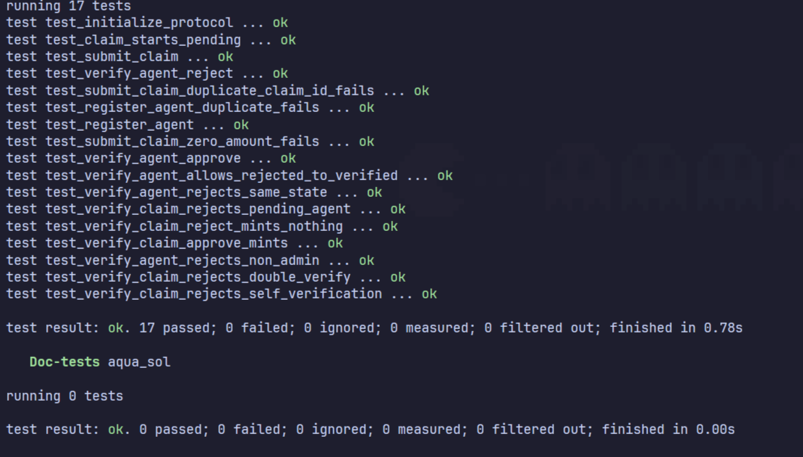
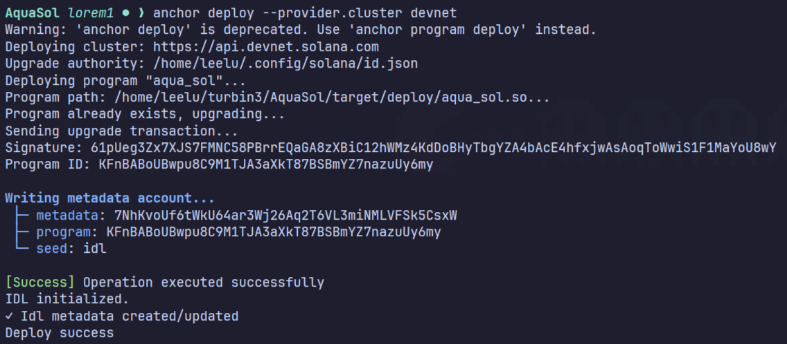
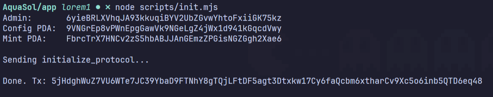

# AquaSol

**Water as RWA.** Collectors declare a volume of water, an independent agent checks
it, and the protocol mints SPL-token credits (`AQUA`) one-for-one against the liters
that were verified.

Program ID (devnet): `KFnBABoUBwpu8C9M1TJA3aXkT87BSBmYZ7nazuUy6my`

---

## What it does

AquaSol turns a verified claim about water into a tokenized claim about water.
There are three roles:

- **Admin** — initializes the protocol and approves or rejects agents who want to
  act as verifiers. Admin powers are enforced on-chain, not in the UI.
- **Agent** — registers once, gets approved by the admin, and from then on reviews
  pending claims and approves or rejects them.
- **Collector** — submits a claim (source name + volume in liters) and receives
  `AQUA` into their token account when an agent approves it.

Three things worth calling out:

**The mint authority is a PDA.** `initialize_protocol` creates the `AQUA` mint with
the Config PDA as its mint authority. Only the program can sign a mint, so tokens
exist exactly when a verified claim says they should.

**The collector does nothing after submitting.** When an agent approves a claim, the
program creates the collector's associated token account on demand and pays for it.
The collector never has to come back online to receive their credits.

**Units.** `AQUA` has 3 decimals and 1 liter maps to 1 base unit, so
`1000 liters = 1.000 AQUA`. A claim's `amount` is stored in liters and passed
straight through as the mint amount — no conversion table, no rounding.

---

## Screenshots

| Tests | Devnet deploy | Protocol initialization |
| --- | --- | --- |
|  |  |  |

---

## Architecture

```
 Admin     initialize_protocol ──►  Config PDA + AQUA mint
                                      (mint authority = Config PDA)
                                    │
 Agent     register_agent ────────►  Agent PDA [Pending]
                                    │
 Admin     verify_agent ───────────►  [Verified]  |  [Rejected]
                                    │
                                    │  only a Verified agent may continue
                                    │
 Collector  submit_claim ──────────►  Claim PDA [Pending]
                                    │
 Agent     verify_claim ───────────►  approved ──► [Verified]
                                    │
                                    │  CPI mint_to, signed by Config PDA
                                    ▼
                                    Collector's AQUA ATA

 Agent     verify_claim ───────────►  rejected ──► [Rejected]
                                                    (nothing minted)
```

The collector signs nothing after `submit_claim` — the agent funds and creates
the collector's ATA during approval.

Three properties the program enforces, and the tests cover:

- Only a `Verified` agent can call `verify_claim` — a pending agent is rejected.
- An agent cannot verify a claim where they are the collector (no self-verification).
- A claim can only be resolved once — `Verified`/`Rejected` claims are not re-settleable.

---

## Instructions

| Instruction | Caller | Effect |
| --- | --- | --- |
| `initialize_protocol` | admin | Creates the Config PDA and the `AQUA` mint |
| `register_agent` | agent | Creates the Agent PDA, status `Pending` |
| `verify_agent` | admin | Sets an agent's status to `Verified` or `Rejected` |
| `submit_claim` | collector | Creates the Claim PDA, status `Pending` |
| `verify_claim` | verified agent | Marks the claim `Verified` + mints, or `Rejected` |

## Accounts & PDAs

| Account | Seeds | Fields |
| --- | --- | --- |
| `Config` | `["config"]` | `admin`, `water_mint`, `bump` |
| AQUA mint | `["water_mint"]` | 3 decimals, authority = Config PDA |
| `Agent` | `["agent", agent]` | `agent`, `metadata_uri`, `status`, `bump` |
| `Claim` | `["claim", collector, claim_id_le]` | `collector`, `source_name`, `amount`, `claim_id`, `status`, `bump` |

Claim seeds use `claim_id` as 8-byte little-endian, so a collector can never
re-submit the same `claim_id` — the PDA is taken.

---

## What changed from the original spec

The spec treated KYC eligibility and agent status as *caller preconditions*. Two
things had to move on-chain for the program to stand on its own:

- **`verify_agent` was added.** Registration is permissionless and lands every
  agent in `Pending`. The admin is the only party that can grant verification
  authority, and that is a program instruction, not a UI check.
- **`kyc_verified` / `active` booleans became an `AgentStatus` enum**
  (`Pending` / `Verified` / `Rejected`), so agent state is one field with an
  explicit lifecycle instead of two flags that can disagree.

---

## Layout

```
AquaSol/
├── programs/aqua-sol/       # Anchor program
│   ├── src/
│   │   ├── lib.rs           # instruction handlers
│   │   ├── state.rs         # Config, Agent, Claim
│   │   ├── constants.rs     # PDA seeds, AQUA_DECIMALS
│   │   ├── error.rs
│   │   └── instructions/
│   └── tests/               # LiteSVM integration tests
└── app/                     # Next.js 16 frontend (admin / agent / collector)
    ├── app/                 # role routes
    ├── components/
    ├── lib/                 # PDA derivation, program client, IDL
    └── scripts/init.mjs     # one-shot protocol initializer
```

Tests run on [LiteSVM](https://github.com/LiteSVM/litesvm) rather than a
local validator — the suite runs in-process in under a second.

---

## Run it yourself

The admin is just whoever calls `initialize_protocol` first — so run your own
cluster and it's you.

**1. Get a keypair** (this becomes the admin):

```bash
solana-keygen new --no-bip39-passphrase
```

Writes `~/.config/solana/id.json` and prints 12 words. Keep them for step 5.

**2. Get the compiled program** — no Rust needed, pull it off devnet:

```bash
solana program dump -u devnet KFnBABoUBwpu8C9M1TJA3aXkT87BSBmYZ7nazuUy6my aqua_sol.so
```

**3. Start a validator with the program at its real address** (genesis funds
`~/.config/solana/id.json`, so nothing to airdrop):

```bash
solana-test-validator --bpf-program KFnBABoUBwpu8C9M1TJA3aXkT87BSBmYZ7nazuUy6my aqua_sol.so
```

**4. Create the protocol** — second terminal, from the repo root:

```bash
cd app && RPC_URL=http://127.0.0.1:8899 node scripts/init.mjs
```

**5. Run the frontend** — same terminal, still in `app/`:

```bash
npm install
NEXT_PUBLIC_RPC_URL=http://127.0.0.1:8899 npm run dev
```

Import the 12 words from step 1 into Phantom and open http://localhost:3000. The
CLI keypair and the browser wallet **must be the same keypair** — `/admin` compares
the connected wallet against `Config.admin`, so a different one gets "Access
denied". After that everything works normally: approve an agent as admin, submit a
claim as collector, approve it as agent, watch AQUA mint.

Tests, if you have Rust: `anchor build && cargo test` — 17 tests on LiteSVM, no
validator needed.

```
note: this "Run it yourself" has been generated by a LLM, crosscheck it yourself and troubleshoot yourself accordingly.  
```
---

## Roadmap

The buyer side of the marketplace is not built yet. From the spec:

- **`purchase_credits`** — buyer pays into an escrow account and receives `AQUA`
  at the time of purchase.
- **`confirm_delivery`** — buyer confirms receipt and the escrowed payment is
  released to the collector.

so on..

---

Turbin3 Q3 26 Builders Capstone by **Akshay [@akshaaytwt](https://github.com/akshayysm)** & **Leela Sankhar [@0xleelu](https://github.com/0xleelu)**
